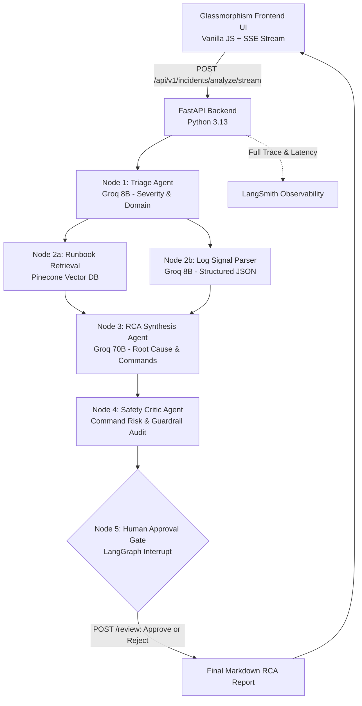
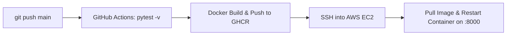

# SentinelRCA — Autonomous IT Incident Triage & Root-Cause Analysis Engine

[](https://github.com/Ardhimahesh13/sentinel-rca/actions/workflows/deploy.yml)
[](https://www.python.org/)
[](https://fastapi.tiangolo.com/)
[](https://langchain-ai.github.io/langgraph/)
[](https://www.docker.com/)
[](https://aws.amazon.com/ec2/)

**SentinelRCA** is an end-to-end, production-deployed **Multi-Agent AI Incident Response Engine** built with **LangGraph**, **FastAPI**, **Pinecone**, and **Groq**. It ingests raw production error logs, triages severity, retrieves relevant internal runbooks via RAG in parallel with structured log signal extraction, synthesizes root-cause analysis (RCA), audits proposed CLI commands through an automated Safety Critic, and pauses at a **Human-in-the-Loop (HITL)** approval gate before generating the final incident report.

---

## Live Architecture



---

## Key Engineering Highlights

* **Parallel Multi-Agent Orchestration (`LangGraph`):** Uses a fan-out/fan-in `StateGraph` where **Pinecone Runbook Retrieval** and **Log Signal Parsing** execute concurrently after Triage, cutting end-to-end latency.
* **Tiered LLM Routing (`Groq`):** Routes high-frequency classification, extraction, and safety checks to a fast **8B model**, while reserving the **70B model** for complex root-cause synthesis.
* **Strict Structured Output Enforcement:** All agent nodes use `method="json_mode"` paired with strict **Pydantic v2** schemas to eliminate tool-calling hallucinations and guarantee predictable downstream state transitions.
* **Human-in-the-Loop (HITL) Safety Gate:** Graph execution checkpoints and pauses before finalizing remediation plans. Engineers review the Safety Critic's audit and either approve or reject/escalate via a dedicated REST endpoint.
* **Real-Time SSE Streaming:** Streams live node state transitions and execution traces from FastAPI to the browser over **Server-Sent Events (`text/event-stream`)**—no polling required.
* **Automated CI/CD to AWS EC2:** Every push to `main` runs `pytest` unit tests, builds and pushes a container image to **GitHub Container Registry (GHCR)**, and deploys automatically to **AWS EC2** via SSH.

---

## Tech Stack

| Layer | Technology | Purpose |
| :--- | :--- | :--- |
| **Orchestration** | LangGraph, LangChain | Multi-agent state machine, parallel branches, HITL interrupts |
| **LLM Inference** | Groq (Llama 3 8B & 70B) | Ultra-low-latency tiered inference with JSON mode |
| **Vector Search (RAG)** | Pinecone | Semantic retrieval of historical incident runbooks |
| **Backend API** | FastAPI, Uvicorn, Pydantic v2 | Async REST + SSE streaming endpoints and schema validation |
| **Frontend UI** | HTML5, CSS3, Vanilla JS | Lightweight Glassmorphism dashboard with live DAG visualization |
| **Observability** | LangSmith | End-to-end trace inspection, token tracking, and latency debugging |
| **Testing** | Pytest | Automated unit test suite executed in CI before every build |
| **DevOps & Cloud** | Docker, GitHub Actions, GHCR, AWS EC2 | Containerized CI/CD deployment on Ubuntu 24.04 (`ap-south-1`) |

---

## CI/CD Deployment Pipeline



---

## API Reference

| Method | Endpoint | Description |
| :--- | :--- | :--- |
| `GET` | `/` | Serves the Glassmorphism frontend UI |
| `GET` | `/health` | Health check endpoint (`{"status": "ok"}`) |
| `POST` | `/api/v1/incidents/analyze/stream` | Accepts `{"raw_log": "..."}` and streams SSE events (`started`, `node_update`, `paused`, `error`) |
| `POST` | `/api/v1/incidents/{thread_id}/review` | Resumes a paused LangGraph thread with `{"approved": true/false, "feedback": "..."}` and returns the final RCA report |

---

## Project Structure

```text
sentinel-rca/
├── .github/workflows/
│   └── deploy.yml          # CI/CD: pytest -> GHCR Docker build -> EC2 SSH deploy
├── app/
│   ├── graph/
│   │   ├── state.py        # TypedDict state schema for LangGraph
│   │   ├── nodes.py        # Triage, RAG, Log Parser, RCA, Safety Critic, Report nodes
│   │   └── workflow.py     # StateGraph wiring, parallel edges, and HITL interrupt
│   ├── core/               # Configuration, LLM clients, Pinecone retrieval
│   └── main.py             # FastAPI app, SSE streaming, review endpoint, static mount
├── frontend/
│   ├── index.html          # Enterprise Glassmorphism UI layout
│   ├── style.css           # Light-mode glassmorphism styling & pipeline animations
│   └── app.js              # SSE reader, DAG state renderer, sample logs, HITL controls
├── tests/                  # Pytest unit test suite
├── Dockerfile              # Production Python 3.13 container image
├── requirements.txt        # Pinned Python dependencies
└── pytest.ini              # Test runner configuration
```

---

## Local Setup & Quickstart

### 1. Clone the Repository
```bash
git clone [https://github.com/Ardhimahesh13/sentinel-rca.git](https://github.com/Ardhimahesh13/sentinel-rca.git)
cd sentinel-rca
```

### 2. Create a Virtual Environment & Install Dependencies
```bash
python -m venv venv
# Windows
venv\Scripts\activate
# macOS / Linux
source venv/bin/activate

pip install -r requirements.txt
```

### 3. Configure Environment Variables
Create a `.env` file in the project root (no quotes around values if running via Docker):
```env
GROQ_API_KEY=your_groq_api_key
PINECONE_API_KEY=your_pinecone_api_key
PINECONE_INDEX_NAME=your_pinecone_index_name
LANGSMITH_API_KEY=your_langsmith_api_key
LANGSMITH_TRACING=true
LANGSMITH_PROJECT=sentinel-rca
```

### 4. Run Tests & Start the Server
```bash
pytest -v
uvicorn app.main:app --reload --port 8000
```

Open **`[http://127.0.0.1:8000/](http://35.154.46.69:8000/)`**, click any built-in sample incident (e.g., *PostgreSQL Pool Exhaustion*, *Nginx 502*, *JWT 401 Spike*, or *Docker OOMKilled*), and click **Analyze Incident**.

---

## Author

**Ardhi Mahesh**
* **GitHub:** [@Ardhimahesh13](https://github.com/Ardhimahesh13)
* **Email:** ardhimahesh96@gmail.com
